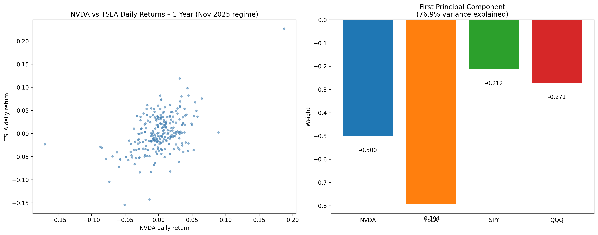

# roadtoquantmf

My study path into quantitative finance: a 25-week plan (November 2025 to May 2026) and the work for week 1. Only week 1 is done in this repo.

The goal, as written in `Week 1.md`: "Interview-ready quant developer / researcher role (finance or tech)". The plan gives every week a topic, free resources, a weekly project and LeetCode targets, and this repo is where the projects were meant to go. It's a learning repo, not finished work.

## What's inside

- `Overview.md`: the plan, in two versions one after the other. The first ties every week to an economics topic. The second adds a computing topic to most weeks (parallel, cluster, cloud, grid and GPU computing).
- `Week 1.md`: the week 1 checklist, all ticked.
- `notebooks/linear_algebra_basics.ipynb`: the week 1 project. It downloads one year of daily closes for NVDA, TSLA, SPY and QQQ with yfinance, computes daily returns and the annualised covariance matrix (× 252), and runs an eigen decomposition with NumPy (PCA). It plots NVDA vs TSLA returns, the weights of the first principal component, and that component's cumulative return.



## Results

Saved run, 249 trading days up to 2025-11-17: the first principal component explains 76.9% of total variance. Weights: NVDA −0.500, TSLA −0.794, SPY −0.212, QQQ −0.271.

Same code on the year to 2026-11-06 (250 days): 73.1%. Weights: NVDA −0.545, TSLA −0.748, SPY −0.197, QQQ −0.325.

## Run

```
pip install numpy pandas matplotlib yfinance jupyter
jupyter notebook notebooks/linear_algebra_basics.ipynb
```

The data comes from yfinance at run time, so it needs internet and the numbers change with the date. Python 3.14 was used for the saved run.

## How it was built

The plan, the checklist and the notebook are my commits (6 of 8). A coding agent wrote this README.

## What I learned

- Daily covariance becomes annual with × 252, the number of trading days.
- PCA on a covariance matrix follows variance. TSLA (annualised variance 0.428) and NVDA (0.250) carry most of the first component, SPY (0.039) and QQQ (0.056) less, even though all four weights have the same sign. The sign of an eigenvector itself is arbitrary.
- One year is one regime: 76.9% in the saved run, 73.1% a year later.

## Status

Week 1 of 25, committed 2025-11-18. No work on weeks 2 to 25 is in this repo.

Left:
- The checklist names the notebook `01_linear_algebra_basics.ipynb` and says it plots the first two eigenvectors. The file is `linear_algebra_basics.ipynb` and plots the first one.
- The notebook uses `np.linalg.eig`. For a symmetric matrix like this one, `np.linalg.eigh` is the better call.

No license file in this repo yet.
